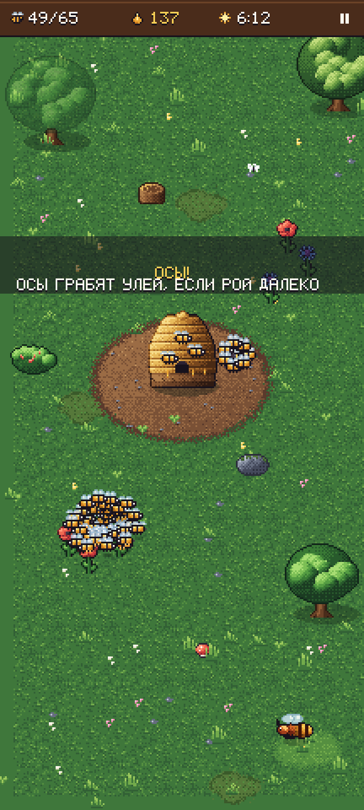

# РОЙ (SWARM)

Мобильная 2D pixel-art игра для Android: игрок ведёт не пчелу, а целый живой рой — десятки, потом сотни пчёл. Собирай нектар, неси в улей, выводи новых пчёл, качай улучшения и отбивайся от ос и шершней до конца лета.

Это **вертикальный срез**: одна карта, полный цикл «сбор → улей → рост → бой», сессия 5–10 минут.



> Картинка выше — **макет**, собранный скриптом `tools/art/mockup.py` из реальных спрайтов атласа по той же раскладке, что и рендер. Это не скриншот из движка.

---

## Запуск

1. **Unity 6** (6000.0 LTS или новее), Built-in Render Pipeline. Открыть корень репозитория через Unity Hub.
2. При первом открытии проект настраивается сам: создаётся `Assets/Swarm/Scenes/Main.unity`, она прописывается в Build Settings, выставляются Player Settings (портрет, IL2CPP, ARM64+ARMv7, Gamma). Вручную — меню **SWARM → Setup Project**.
3. Нажать **Play**. Сцена пустая — всё собирается из кода (`GameBootstrap`). В редакторе управление мышью.

### Сборка APK

- Переключить платформу на Android (File → Build Profiles / Build Settings → Android → Switch Platform).
- Меню **SWARM → Build Android APK** → `Builds/Android/Swarm.apk` (подпись debug-ключом).
- Из командной строки:

```
Unity -batchmode -quit -projectPath . -buildTarget Android \
  -executeMethod Swarm.EditorTools.SwarmProjectSetup.BuildAndroidBatch -logFile build.log
```

### Облачная сборка (GitHub Actions, без ПК)

Workflow `.github/workflows/build-android.yml` перенят из рабочей сборки первой игры: GameCI CLI + Unity 6000.0.36f1 на раннере GitHub.

1. Один раз: Settings → Secrets and variables → Actions → добавить `UNITY_EMAIL` и `UNITY_PASSWORD` (тот же Unity-аккаунт).
2. Каждый пуш в `main`, затрагивающий `Assets/`, `Packages/`, `ProjectSettings/`, запускает сборку (или вручную: Actions → Build Android APK → Run workflow).
3. Результат:
   - ветка **`apk-latest`** — `Swarm.apk`, `probe.txt` (замер симуляции в Unity), `shots/*.png` — **настоящие кадры игры**, отрендеренные Unity в CI;
   - ветка **`ci-logs`** — лог сборки, секреты вырезаны.

Лицензия Personal одна на обе игры — не запускать сборки двух репозиториев одновременно.

### Если что-то не так

- **Ошибка `InvalidOperationException` про Input** — Active Input Handling должен быть `Input Manager (Old)` или `Both`. Setup Project и CI-сборка переключают это сами.
- **Цвета блёклые/пересвеченные** — Player Settings → Color Space = `Gamma` (Setup Project выставляет это сам).

---

## Как играть

**Режимы:** КАМПАНИЯ (3 сезона: ВЕСНА/луг → ЛЕТО/сад → ОСЕНЬ/болото, открываются звёздами), ВЫЖИВАНИЕ (бесконечные круги волн, звёзды за 10/20/30 минут), ЗАДАНИЕ ДНЯ (одна карта у всех на сутки по UTC). Прогресс, рекорды и 12 достижений сохраняются. Версия сборки — внизу главного меню.

| | |
|---|---|
| **Палец** | рой летит к точке касания с инерцией |
| **Второй палец** | отделяет отряд и шлёт его в другую точку (сбор/атака) |
| **Удержание у врага** | ~0.3 с неподвижно — тепловой шар: враг обездвижен, урон ×2.2, часть пчёл гибнет от перегрева. Медведя шар не берёт |
| **Улей → МАТКА** | доля мёда на расплод: 0/25/50/75/100%. Ночью матка работает вдвое быстрее |
| **Улей → ЗАЩИТНИКИ** | нанять по 3 солдата (до 24): навсегда охраняют улей, жалят ×2.5, лечатся у летка |
| **Улей → улучшения** | СОТЫ (лимит роя), НОША, ЖАЛО, КРЫЛЬЯ |
| **Дары колонии** | на 40/80/120 пчёлах — выбор 1 из 3 перков |
| **Враги** | осы (грабят улей; есть осиное гнездо — разрушь его), шершни, медведь (крадёт мёд, уходит при 35% здоровья), колонны муравьёв |
| **Рывок врага** | враг замирает и дрожит — затем бросается. Уведи рой |
| **Опасности** | тень птицы — через 1.6 с пике, уведи рой; паутина между деревьями — пролети роем, чтобы порвать |
| **Небо** | день/ночь (ночью цветы закрыты, враги спят), дождь (осы прячутся), ветер (сносит рой), жара (жажда — лети к пруду) |
| **Цветы** | случайно прорастают новые, иногда редкие золотые (нектар ×3); дважды за лето зацветает липа |
| **Туман войны** | карта открывается по мере полёта; разведчицы танцуют — метки найденного нектара |

**Цель сезона:** к концу лета иметь нужное число пчёл и мёда (ВЕСНА 100/450, ЛЕТО 120/600, ОСЕНЬ 130/700) — ★★★. Иначе зимовка: ★★ — 85 пчёл и 240 мёда, ★ — 50 и 140.

## Архитектура

```
Assets/Swarm/
├─ Resources/            SwarmAtlas.png (сгенерирован), SwarmSprite.shader
├─ Editor/               автонастройка проекта, импорт атласа, сборка APK
└─ Scripts/
   ├─ Simulation/        чистая игровая логика, не знает о рендере
   │   GameSim           корень: шаг мира, условия победы/поражения, команды (вывод пчёл, улучшения)
   │   BeeSwarm          рой как SoA-массивы, boids + задачи (сбор/атака/доставка)
   │   SpatialGrid       сетка соседей, пересборка O(n) без аллокаций
   │   EnemySystem       осы/шершни: охота, грабёж улья, бегство, укусы
   │   WaveDirector      расписание волн, отсрочки, круги выживания
   │   HazardSystem      птицы и паутина;  SkySystem — день/ночь и погода;  FogMap — туман и метки разведчиц
   │   Levels, Perks     сезоны/режимы, дары колонии
   │   FlowerField, WorldMap, Colony, SimConfig, SimEvents, Rng
   ├─ Presentation/      всё, что рисует
   │   PixelScreen       pixel-perfect: рендер в низкое RT (~216 px по ширине) + целый масштаб на экран
   │   QuadBatch         один меш = один draw call на слой, без аллокаций в кадре
   │   WorldRenderer     земля, декор, y-сортировка, рой, враги, кроны, живое окружение
   │   FxSystem          частицы и всплывающие числа на пулах
   │   PixelFont         пиксельный шрифт с кириллицей + TextBuf (числа без аллокаций)
   ├─ UI/                immediate-mode пиксельный UI: меню, HUD, улей, пауза, итоги
   ├─ Audio/             процедурный синтез звука (гул роя, сэмплы событий)
   └─ Game/              GameRoot (состояния, фиксированный шаг 60 Гц, камера), GameBootstrap
```

**Принципы**

- **Симуляция отделена от презентации.** `Simulation/` зависит только от `Vector2`/`Mathf`; общается с остальным через `SimInput` на входе и буфер `SimEvents` на выходе. Поэтому её можно гонять без движка (см. ниже).
- **Ни одного GameObject на сущность.** Пчёлы, враги, цветы, трава, частицы — данные в массивах. На весь кадр ~14 draw call (слои + UI + вывод).
- **Ноль физики.** Свои круговые коллизии и сетка соседей.
- **Ноль аллокаций в кадре** в игровом цикле: преаллоцированные массивы, `Mesh.SetVertices/SetUVs/SetColors/SetTriangles` с диапазонами, свой форматтер чисел.
- **Pixel-perfect без пакетов.** Мир и UI рендерятся в RT с целым масштабом под любое разрешение; позиции округляются до пикселя; учитывается safe area (чёлки).
- **Детерминизм.** Свой `Rng`, фиксированный шаг 1/60 — одинаковый сид даёт одинаковую партию.

**Рой как организм.** Каждой пчеле назначен слот в спирали с золотым углом вокруг центра роя; слоты медленно вращаются и «дышат». Поверх — разделение с соседями через сетку, выравнивание по скорости роя, блуждающий шум, облёт деревьев/камней. Пчела сама решает задачу: ближайший враг в радиусе агрессии → облепить и жалить (с лимитом мест вокруг врага), иначе свободная ёмкость и цветок рядом → собирать, иначе рой у улья и есть ноша → сдать. Далеко отставшая пчела бросает всё и догоняет рой.

---

## Инструменты

| | |
|---|---|
| `tools/art/gen_art.py` | генератор всей графики: единая палитра, спрайты, тайлы, иконки, логотип, кириллический шрифт 5×7 → атлас + `AtlasData.cs` |
| `tools/art/mockup.py` | макет кадра из атласа для проверки цельности арта |
| `tools/simtest/` | headless-прогон симуляции на .NET: бот играет полные сессии на разных сидах, печатает метрики (победы, время, потери, разброс роя, застревания) |
| `tools/compilecheck/` | компиляция всех скриптов `Assets` против стабов Unity + `check_api.py`, сверяющий стабы с реальными определениями Unity 6 |

```
python3 tools/art/gen_art.py                       # перегенерировать атлас
cd tools/simtest && dotnet run -c Release -- 8     # 8 сидов × 2 уровня бота
cd tools/compilecheck && dotnet build              # компиляция
npm pack unity-types && tar xzf unity-types-*.tgz  # определения Unity 6 для сверки
python3 tools/compilecheck/check_api.py package
```

---

## Что проверено, а что нет

Разработка велась в окружении **без Unity Editor** (установить его там было невозможно). Поэтому:

**Проверено фактически**
- Все 27 скриптов (рантайм + Editor) компилируются без ошибок и предупреждений против стабов API.
- Все 405 использованных членов `UnityEngine` (типы, свойства, методы с арностью, значения enum) существуют в Unity 6 — сверено с определениями, сгенерированными из сборок Unity 6000.5. Проверка ловит выдуманные члены и неверную арность (протестировано на подсунутых ошибках).
- Симуляция прогнана headless ботом: ~650 тыс. шагов. Рой сплочён (средний разброс ~23 px), ни одна пчела не застревает в препятствиях, враги грабят улей и убивают пчёл, деревья облетаются. Баланс: ~70% побед у бота, победа за 4:46–9:18, в среднем ~7 минут.
- Производительность симуляции: ~85 мкс на шаг при 120+ пчёлах на десктопном .NET.
- Все символы строк интерфейса есть в шрифте.

**Не проверено (нужен Unity)**
- Запуск в редакторе и на устройстве, визуальный результат рендера, компиляция шейдера.
- API `UnityEditor` (в доступных определениях его нет): `PlayerSettings`, `BuildPipeline`, `TextureImporter` — используются только давно стабильные вызовы.
- Сборка APK.
- Ощущение управления и баланс на живом игроке — бот грубый, числа в `SimConfig` надо дотюнить плейтестом.

---

## Сторонние материалы

- **Kenney Particle Pack** (CC0, kenney.nl) — исходники частиц в `tools/art/vendor/kenney`; генератор атласа уменьшает их до 8–17 px и квантует под пиксель-арт (кольца ударов, искры, дым, дуги, пламя теплового шара, штрихи рывка).
- **Brackeys VFX Bundle** (CC0) — просмотрен; текстуры повторяют набор Kenney, сцены и шейдеры — формат Godot, поэтому не использовались.
- **awesome-gamedev-agent-skills** (Apache 2.0) — применены правила навыка game-feel: тряска через «травму» (амплитуда = травма², затухание), hit-stop на крупных убийствах по реальному времени без блокировки ввода, отклик по уровням важности, «поп» чисел, опция «меньше тряски»; сверены camera-systems, game-ui-ux, audio-design, performance-optimization.

## Куда расти

- Мета-прогрессия улья между партиями, больше сезонов и боссов.
- Порт части эффектов pixelfx (MIT) под палитру игры.
- Перенос `BeeSwarm.Step` на Burst/Jobs при росте роя до тысяч.
